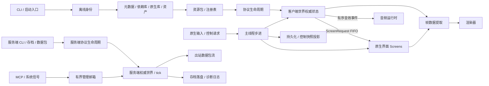

# 总体架构与主链路

## 目标边界

BBB 是 Minecraft Java 26.1 的仓库原生（repo-native）外部多人客户端、WebGPU 浏览器客户端与无头独立服务端，不是官方 JAR、Bevy、Azalea 或其它客户端/服务端技术栈的封装层。客户端拥有协议解码、可见世界副本、本地预测、资源、渲染、音频、UI、输入、持久化和诊断边界（桌面原生与 WASM + `bbb-web-host` 浏览器网关共用同一套模拟与 WGSL 管线，无头差分验证由独立的 `bbb-client-probe` 承载）；BBB 服务端作为独立进程拥有多人权威世界、tick 调度、玩法、存档/数据包与 MCP 管理边界。二者通过 Vanilla 26.1 线协议连接，不共享运行时世界。

该图表示所有权链，不表示每个系统都复制状态。数据包只在协议与网络边界被解释，世界事实进入世界存储，交互状态进入原生 `Screens`，瞬时副作用通过显式事件接口传递。渲染器每帧只消费从同一借用视图提取的输入投影。

## 仓库原生边界

| 边界 | 拥有 | 不拥有 | 输入 → 输出 | 生命周期与 crate 归属 |
| --- | --- | --- | --- | --- |
| 协议层 | 线协议类型、编解码器、26.1 生成事实、碰撞求解、纯光照/体转向 | 套接字、世界对象 | 字节流 ↔ 强类型数据包 | 固定协议版本，未知输入拒绝；`bbb-facts`、`bbb-protocol` |
| 网络与运行时 | TCP/WebSocket 传输、连接阶段、队列、profile HTTP、Web 网关 | 世界语义、资源包目录 | 强类型数据包 → 有序事件 | 握手/配置/游玩/关闭；`bbb-client-net`、`bbb-client`、`bbb-client-probe`、`bbb-web-host` |
| 注册表与数据 | 当前会话注册表与 holder 解析 | GPU 资源 | 配置期数据 → 可查询 ID | 重连重建，无效引用拒绝；`bbb-client-world`、`bbb-registry-codec` |
| 资源包与资产 | 资源包叠层、资产索引、`virtual_store`、解码预算 | 绘制状态 | 资源提供者 → `ClientResourceGeneration` | 重载原子发布，失败保留旧代；`bbb-client-assets`、`bbb-client-render` |
| 客户端世界 | 区块/实体/菜单/注册表、`local_time`、`block_outline`、本地预测 | 活动屏幕、GPU/音频后端 | 游玩包/动作 → 世界状态与副作用 | 绑定单次会话，断线清理；`bbb-client-world` |
| 渲染器输入 | 帧一致投影、`wasm_sync`、`terrain_upload`、`item_models::tooltip` | 客户端权威世界 | 世界 + 资源 → 渲染帧输入 | 每帧重建或增量提取；`bbb-client`、`bbb-render-types` |
| 渲染器 | GPU 资源、渲染管线、排序与纯 Rust `ab_glyph` 字体光栅化 | 游戏权威状态、HTTP/FFI/`icu_*` | 帧输入 + 资源投影 → 呈现画面 | 绑定交换链/资源代次；`bbb-client-render` |
| 原生控制与输入 | 窗口事件、本地意图、控制快照、反向隧道 | 服务端权威移动、第二队列 | 系统/控制意图 → FIFO → 动作/发包 | 绑定一次，`LoopWake` 唤醒；`bbb-client`、`bbb-mcp`、`bbb-web-host` |
| 界面层 | 活动 `Screen`、返回链、编辑/焦点/输入法、本帧 HUD 投影 | 网络包真值、GPU 资源 | 世界/输入/资源 → 强类型 HUD | `bbb-client::input` 拥有，渲染器绘制 |
| 音频层 | 原生（OpenAL；`kira` 仅测试）与浏览器 `webaudio` 声道 | 世界音效真值 | 世界音效事件 → 音频播放 | 设备失败由平台归因；`bbb-client-audio` |
| 客户端持久化 | 桌面原子文件与浏览器 `localStorage` 存储 | 会话世界状态 | 强类型快照 ↔ 本地存储 | 按需加载/保存，有界恢复；`bbb-client` |
| 服务端网络与运行时 | 监听器、连接阶段、压缩、预编码广播、CLI、系统信号 | 世界规则、客户端事件状态 | 套接字/管理请求 → 有序 tick 输入 | 无头进程（Linux/macOS 发布，Windows 开发与 E2E）；`bbb-server-net`、`bbb-server` |
| 服务端世界与数据 | 权威维度/区块/实体/玩家/tick、数据包、26.1 存档 | 渲染器、客户端世界 | 数据包/tick/数据 → 状态变更与落盘 | `bbb-server-core`、`bbb-server-types`、`bbb-server-datapack`、`bbb-server-persistence` |
| 服务端管理 | 强类型管理服务、MCP schema/鉴权/审计、轻量 CLI | 直接借用世界、第二命令系统 | MCP/信号 → 有界邮箱 → 结果 | 默认仅环回地址，远程需显式配置；`bbb-mcp`、`bbb-server-admin`、`bbb-admin` |

关键子层与解耦说明：

- **基础与共享语义**：零工作区依赖的 `bbb-facts` 拥有 26.1 固定事实（含 `default_attributes_26_1`）、纯查询、扫掠碰撞与射线裁切（`collision`）及爆炸数学（`explosion`）；`bbb-protocol` 拥有线协议编解码器、共享光照核心（`chunk_light`）与生物体转向（`entity_body_rotation`）；`bbb-render-types` 单向依赖 `bbb-facts` 与 `bbb-protocol`；`bbb-registry-codec` 不依赖 `bbb-render-types`。
- **客户端与网关解耦**：`bbb-client-net` 不依赖世界与资产层；`bbb-client-probe` 承载无头 `probe` 与 `bbb-replay-diff`；`bbb-web-host` 自行解析和打包 Vanilla 资源，零 `bbb-client`/`wgpu`/`winit` 依赖。网关集成测试通过 `bbb-client-assets` 验证浏览器客户端可以读取资源包。`bbb-client-world` 的本地移动碰撞复用 `bbb_facts::collision`。
- **服务端数据分离**：`bbb-server-core::world` 为唯一 tick 写者；`bbb-server-types` 拥有无宿主服务端值类型与纯方块查询；`bbb-server-datapack` 拥有数据包、动态注册表（`/reload` 保持启动冻结注册表）与预设生成源；`bbb-server-persistence` 与 `bbb-server-worldgen`、`bbb-server-datapack` 完全解耦（26.1 存档的兼容范围和失败保证见[服务端保存与重载](../mechanisms/persistence/server-save-and-reload.md)）；`bbb-admin` 仅依赖 `bbb-mcp`。

## Workspace 24-crate 生产依赖有向无环图（DAG）

下图对应 `crates/*/Cargo.toml` 的生产 `[dependencies]`（以及 `bbb-client` 按目标门控的 `bbb-client-audio`、非 `wasm32` 的 `bbb-client-probe` 与 `bbb-mcp`）；底层零工作区依赖叶包为 `bbb-facts`、`bbb-client-clock`、`bbb-mcp` 与 `bbb-xtask`，不存在任何反向边或环：

```mermaid
flowchart TD
  subgraph leaves["零工作区依赖叶包"]
    facts["bbb-facts（零依赖：事实 + 碰撞 + 爆炸）"]
    clock["bbb-client-clock（零依赖）"]
    mcp["bbb-mcp（零依赖）"]
    xtask["bbb-xtask（零依赖：开发/worker/Web 工具链入口）"]
  end

  subgraph shared["共享协议与值层"]
    protocol["bbb-protocol"]
    reg_codec["bbb-registry-codec"]
    render_types["bbb-render-types"]
  end

  subgraph server["独立服务端与管理层"]
    srv_types["bbb-server-types"]
    srv_datapack["bbb-server-datapack"]
    srv_persist["bbb-server-persistence"]
    srv_worldgen["bbb-server-worldgen"]
    srv_core["bbb-server-core"]
    srv_net["bbb-server-net"]
    srv_admin["bbb-server-admin"]
    srv_bin["bbb-server"]
    admin_cli["bbb-admin（CLI）"]
  end

  subgraph client["客户端、探针与 Web 网关层"]
    cli_assets["bbb-client-assets"]
    cli_audio["bbb-client-audio"]
    cli_net["bbb-client-net"]
    cli_world["bbb-client-world"]
    cli_render["bbb-client-render"]
    cli_probe["bbb-client-probe（probe + bbb-replay-diff）"]
    cli_bin["bbb-client（桌面端 + WASM cdylib）"]
    web_host["bbb-web-host（Web 网关）"]
  end

  facts --> protocol
  facts --> reg_codec
  protocol --> reg_codec
  facts --> render_types
  protocol --> render_types

  facts --> srv_types
  protocol --> srv_types
  reg_codec --> srv_types

  facts --> srv_datapack
  protocol --> srv_datapack
  reg_codec --> srv_datapack
  srv_types --> srv_datapack

  facts --> srv_persist
  protocol --> srv_persist
  reg_codec --> srv_persist
  srv_types --> srv_persist

  facts --> srv_worldgen
  protocol --> srv_worldgen
  reg_codec --> srv_worldgen
  srv_types --> srv_worldgen
  srv_datapack --> srv_worldgen

  facts --> srv_core
  protocol --> srv_core
  reg_codec --> srv_core
  srv_types --> srv_core
  srv_datapack --> srv_core
  srv_persist --> srv_core
  srv_worldgen --> srv_core

  facts --> srv_net
  protocol --> srv_net

  mcp --> srv_admin
  protocol --> srv_admin
  srv_core --> srv_admin

  facts --> srv_bin
  protocol --> srv_bin
  srv_types --> srv_bin
  srv_datapack --> srv_bin
  srv_persist --> srv_bin
  srv_core --> srv_bin
  srv_net --> srv_bin
  srv_admin --> srv_bin

  mcp --> admin_cli

  protocol --> cli_assets
  reg_codec --> cli_assets
  render_types --> cli_assets

  cli_assets --> cli_audio
  clock --> cli_audio

  clock --> cli_net
  protocol --> cli_net

  facts --> cli_world
  protocol --> cli_world
  reg_codec --> cli_world
  render_types --> cli_world
  clock --> cli_world
  cli_assets --> cli_world

  protocol --> cli_render
  reg_codec --> cli_render
  render_types --> cli_render
  clock --> cli_render
  cli_assets --> cli_render

  protocol --> cli_probe
  cli_assets --> cli_probe
  cli_net --> cli_probe
  cli_world --> cli_probe

  protocol --> cli_bin
  render_types --> cli_bin
  clock --> cli_bin
  cli_assets --> cli_bin
  cli_audio --> cli_bin
  cli_net --> cli_bin
  cli_world --> cli_bin
  cli_render --> cli_bin
  cli_probe -. "not(wasm32)" .-> cli_bin
  mcp -. "not(wasm32)" .-> cli_bin

  protocol --> web_host
  mcp --> web_host
```

## 与 Vanilla 所有者的关系

Vanilla 客户端常把状态与行为集中在 `Minecraft`、`ClientPacketListener`、`ClientLevel`、`LevelRenderer`、`LocalPlayer`；服务端集中在 `Main`、`MinecraftServer`、`DedicatedServer`、`ServerLevel`、`PlayerList`、各 `Server*PacketListenerImpl` 与 JSON-RPC 内部管理服务。BBB 不照搬 Java 类图，而是对齐可观察决策及其输入顺序，再把职责放入对应语义边界。类型布局可以不同，但数据包/tick 顺序、坐标、回退行为、存档格式和消费者看见的事实不能因此改变。

## 四层能力与引擎扩展边界

BBB 将引擎优化、渲染底座、客户端体验增强（QoL）与内部玩法模组划分为四个正交层次，在默认参数下对 Vanilla 26.1 路径保持零额外开销：

| 层次 | 定位 | 配置与生命周期 | 权威位置 |
| --- | --- | --- | --- |
| L1 核心管线 | 替换/精简高开销 Vanilla 实现 | 主干直接内化 | 各世界/渲染/协议 crate |
| L2 渲染底座 | 骨骼动画（`DataDriven` GPU 蒙皮）、点光源（`--dynamic-lights`）与远景 LOD（`--lod-distance`） | CLI / Web 查询参数启动门控 | `bbb-render-types`、`bbb-client-assets`、`bbb-client-render`、`bbb-client` |
| L3 客户端 QoL | 纯客户端信息与交互扩展（`--ext`：`zoom`、`hud_info`、`item_inspector`） | CLI / Web 查询参数按需启用，不写 `options.txt` | `bbb-client`、`bbb-client-world`、`bbb-facts::fuel_burn_times` |
| L4 内部玩法扩展 | 服务端权威实体/行为与会期冻结 `ContentRegistry`（`--mod demo_boss` 与 `--mod-packs`/`--mod-pack` JSON 清单加载） | 服务端启动冻结，配置阶段经 `bbb:content_registry` 同步 | `bbb-protocol::content_registry`、`bbb-server-core`、`bbb-server` |

## 状态流和验证

客户端主链见[协议状态流](../mechanisms/protocol/client-state-flow.md)、[运行时与控制](../mechanisms/runtime/client-runtime-and-control.md)、[输入与交互](../mechanisms/player/client-input-and-interaction.md)、[世界生命周期](../mechanisms/world/client-world-lifecycle.md)与[音频链路](../mechanisms/audio/client-audio-pipeline.md)。
服务端主链见[tick 与世界](../mechanisms/world/server-tick-and-world.md)、[保存与重载](../mechanisms/persistence/server-save-and-reload.md)和[MCP 管理](../mechanisms/control/server-mcp-administration.md)。
两端 crate 与状态分类分别由[客户端边界](client-boundaries.md)、[服务端边界](server-boundaries.md)拥有。

推进原则见 [`AGENTS.md`](../../../AGENTS.md)；未关闭的 Vanilla 差异与范围裁决分别由[客户端功能差异](../../unsupported-client-features.md)和[服务端功能差异](../../unsupported-server-features.md)维护，已选定的 BBB 自有能力登记在[客户端扩展](../../client-extensions.md)。
