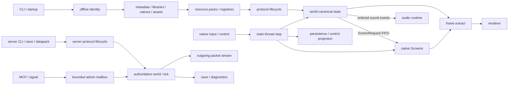

# 总体架构与主链路

## 目标边界

BBB 是 Minecraft Java 26.1 的 repo-native 外部多人客户端、WebGPU 浏览器客户端与 headless
dedicated server，不是官方 jar、Bevy、Azalea 或其它 client/server stack 的 wrapper。客户端拥有
protocol 解码、可见世界副本、本地预测、资源、渲染、音频、UI、输入、持久化和诊断边界（桌面原生与
WASM + `bbb-web-host` 浏览器网关共用同一套模拟与 WGSL 管线，无头差分验证由独立的
`bbb-client-probe` 承载）；BBB 服务端作为独立进程拥有多人 authoritative world、tick、玩法、
存档/datapack 与 MCP 管理边界。二者通过 Vanilla 26.1 wire 连接，不共享 live world。

该图是所有权链，不表示每个系统都复制状态。packet 只在 protocol/net 边界被解释，
世界事实进入 world，交互状态进入 native Screens，瞬时副作用通过显式 effect 接口。
renderer 每帧只消费从同一借用视图提取的输入投影。

## 仓库原生（repo-native）边界

| 边界 | 拥有 | 不拥有 | 输入 → 输出 | 生命周期与 crate 归属 |
| --- | --- | --- | --- | --- |
| protocol | wire 类型、codec、26.1 生成事实、碰撞求解、纯光照/体转向 | socket、世界对象 | bytes ↔ typed packet | 固定协议版本，未知输入拒绝；`bbb-facts`、`bbb-protocol` |
| net/runtime | socket/WS 传输、连接阶段、队列、profile HTTP、Web 网关 | 世界语义、pack 目录 | typed packet → ordered events | handshake/configuration/play/closed；`bbb-client-net`、`bbb-client`、`bbb-client-probe`、`bbb-web-host` |
| registries/data | 当前 session registry 与 holder 解析 | GPU 资源 | configuration data → queryable ids | 重连重建，无效引用拒绝；`bbb-client-world`、`bbb-registry-codec` |
| resource pack/assets | pack stack、asset-index、`virtual_store`、解码预算 | 绘制状态 | providers → `ClientResourceGeneration` | reload 原子发布，失败保旧；`bbb-client-assets`、`bbb-client-render` |
| world | chunk/entity/菜单/registry、`local_time`、`block_outline`、本地预测 | 活动屏幕、GPU/audio | play packet/action → world/effects | session scoped，断线清理；`bbb-client-world` |
| renderer input | 帧一致投影、`wasm_sync`、`terrain_upload`、`item_models::tooltip` | canonical world | world + resources → frame | 每帧重建或增量提取；`bbb-client`、`bbb-render-types` |
| renderer | GPU resources、pipelines、排序与纯 Rust `ab_glyph` 字体光栅 | 游戏权威状态、HTTP/FFI/`icu_*` | frame + 资源投影 → presented image | swapchain/pack generation scoped；`bbb-client-render` |
| native control/input | window events、local intent、control snapshot、反向隧道 | 服务端权威移动、第二队列 | OS/control intent → FIFO → action/packet | 绑定一次，`LoopWake` 唤醒；`bbb-client`、`bbb-mcp`、`bbb-web-host` |
| UI | 活动 Screen、返回链、编辑/焦点/IME、本帧 HUD 投影 | packet truth、GPU 资源 | world/input/resources → typed HUD | `bbb-client::input` 拥有，renderer 绘制 |
| audio | 原生（OpenAL；`kira` 仅测试）与浏览器 `webaudio` voices | 世界音效真值 | world audio event → playback | 设备失败由平台归因；`bbb-client-audio` |
| persistence | 桌面原子文件与浏览器 `localStorage` 存储 | session world | typed snapshot ↔ 本地存储 | lazy load/save，有界恢复；`bbb-client` |
| server network/runtime | listener、连接 phase、压缩、预编码广播、CLI、signal | world 规则、client event state | socket/admin → ordered tick input | 无头进程（Linux/macOS 发布，Windows 开发与 E2E）；`bbb-server-net`、`bbb-server` |
| server world/data | 权威 dimension/chunk/entity/player/tick、datapack、26.1 save | renderer、client world | packet/tick/data → mutation/save | `bbb-server-core`、`bbb-server-types`、`bbb-server-datapack`、`bbb-server-persistence` |
| server admin | typed admin service、MCP schema/auth/audit、轻量 CLI | 直接 world borrow、第二命令系统 | MCP/signal → bounded mailbox → result | loopback 默认，远程显式配置；`bbb-mcp`、`bbb-server-admin`、`bbb-admin` |

关键子层与解耦说明：

- **基础与共享语义**：零 workspace 依赖的 `bbb-facts` 拥有 26.1 固定事实（含 `default_attributes_26_1`）、纯查询、扫掠碰撞与射线裁切（`collision`）及爆炸数学（`explosion`）；`bbb-protocol` 拥有 wire codec、共享光照核心（`chunk_light`）与生物体转向（`entity_body_rotation`）；`bbb-render-types` 单向依赖 `bbb-facts` 与 `bbb-protocol`；`bbb-registry-codec` 不依赖 `bbb-render-types`。
- **客户端与网关解耦**：`bbb-client-net` 不依赖 world/assets；`bbb-client-probe` 承载无头 `probe` 与 `bbb-replay-diff`；`bbb-web-host` 零 `bbb-client`/`wgpu`/`winit` 依赖；`bbb-client-world` 的本地移动碰撞复用 `bbb_facts::collision`。
- **服务端数据分离**：`bbb-server-core::world` 为单 tick writer；`bbb-server-types` 拥有无 host 服务端值类型与纯方块查询；`bbb-server-datapack` 拥有 datapack、动态注册表（`/reload` 保持启动冻结注册表）与预设生成源；`bbb-server-persistence` 与 `bbb-server-worldgen`、`bbb-server-datapack` 完全解耦（26.1 save 的兼容范围和失败保证见保存机制）；`bbb-admin` 仅依赖 `bbb-mcp`。

## Workspace 24-crate 生产依赖有向无环图（DAG）

下图对应 `crates/*/Cargo.toml` 的生产 `[dependencies]`（以及 `bbb-client` 按目标门控的
`bbb-client-audio`、非 `wasm32` 的 `bbb-client-probe` 与 `bbb-mcp`）；底层零 workspace 依赖叶包为
`bbb-facts`、`bbb-client-clock`、`bbb-mcp` 与 `bbb-xtask`，不存在任何反向边或环：

```mermaid
flowchart TD
  subgraph leaves["零 workspace 依赖叶包"]
    facts["bbb-facts (0 deps, facts + collision + explosion)"]
    clock["bbb-client-clock (0 deps)"]
    mcp["bbb-mcp (0 deps)"]
    xtask["bbb-xtask (0 deps, dev/worker/web runner)"]
  end

  subgraph shared["共享协议与值层"]
    protocol["bbb-protocol"]
    reg_codec["bbb-registry-codec"]
    render_types["bbb-render-types"]
  end

  subgraph server["Dedicated Server 与管理层"]
    srv_types["bbb-server-types"]
    srv_datapack["bbb-server-datapack"]
    srv_persist["bbb-server-persistence"]
    srv_worldgen["bbb-server-worldgen"]
    srv_core["bbb-server-core"]
    srv_net["bbb-server-net"]
    srv_admin["bbb-server-admin"]
    srv_bin["bbb-server"]
    admin_cli["bbb-admin (CLI)"]
  end

  subgraph client["客户端、探针与 Web 网关层"]
    cli_assets["bbb-client-assets"]
    cli_audio["bbb-client-audio"]
    cli_net["bbb-client-net"]
    cli_world["bbb-client-world"]
    cli_render["bbb-client-render"]
    cli_probe["bbb-client-probe (probe + bbb-replay-diff)"]
    cli_bin["bbb-client (desktop + WASM cdylib)"]
    web_host["bbb-web-host (gateway)"]
  end

  facts --> protocol
  facts --> reg_codec
  protocol --> reg_codec
  facts --> render_types
  protocol --> render_types

  facts --> srv_types
  protocol --> srv_types
  reg_codec --> srv_types

  facts --> srv_datapack
  protocol --> srv_datapack
  reg_codec --> srv_datapack
  srv_types --> srv_datapack

  facts --> srv_persist
  protocol --> srv_persist
  reg_codec --> srv_persist
  srv_types --> srv_persist

  facts --> srv_worldgen
  protocol --> srv_worldgen
  reg_codec --> srv_worldgen
  srv_types --> srv_worldgen
  srv_datapack --> srv_worldgen

  facts --> srv_core
  protocol --> srv_core
  reg_codec --> srv_core
  srv_types --> srv_core
  srv_datapack --> srv_core
  srv_persist --> srv_core
  srv_worldgen --> srv_core

  facts --> srv_net
  protocol --> srv_net

  mcp --> srv_admin
  protocol --> srv_admin
  srv_core --> srv_admin

  facts --> srv_bin
  protocol --> srv_bin
  srv_types --> srv_bin
  srv_datapack --> srv_bin
  srv_persist --> srv_bin
  srv_core --> srv_bin
  srv_net --> srv_bin
  srv_admin --> srv_bin

  mcp --> admin_cli

  protocol --> cli_assets
  reg_codec --> cli_assets
  render_types --> cli_assets

  cli_assets --> cli_audio
  clock --> cli_audio

  clock --> cli_net
  protocol --> cli_net

  facts --> cli_world
  protocol --> cli_world
  reg_codec --> cli_world
  render_types --> cli_world
  clock --> cli_world
  cli_assets --> cli_world

  protocol --> cli_render
  reg_codec --> cli_render
  render_types --> cli_render
  clock --> cli_render
  cli_assets --> cli_render

  protocol --> cli_probe
  cli_assets --> cli_probe
  cli_net --> cli_probe
  cli_world --> cli_probe

  protocol --> cli_bin
  render_types --> cli_bin
  clock --> cli_bin
  cli_assets --> cli_bin
  cli_audio --> cli_bin
  cli_net --> cli_bin
  cli_world --> cli_bin
  cli_render --> cli_bin
  cli_probe -. "not(wasm32)" .-> cli_bin
  mcp -. "not(wasm32)" .-> cli_bin

  protocol --> web_host
  cli_assets --> web_host
  mcp --> web_host
```

## 与 Vanilla owner 的关系

Vanilla 客户端常把状态与行为集中在 `Minecraft`、`ClientPacketListener`、`ClientLevel`、
`LevelRenderer`、`LocalPlayer`；服务端集中在 `Main`、`MinecraftServer`、
`DedicatedServer`、`ServerLevel`、`PlayerList`、各 `Server*PacketListenerImpl` 与
JSON-RPC internal services。BBB 不照搬 Java 类图，而复刻可观察决策及其输入顺序，再把
责任放入语义边界。类型布局可以不同，但 packet/tick 顺序、坐标、fallback、save schema
和消费者看见的事实不能因此改变。

## 四层能力与引擎扩展边界

BBB 将引擎优化、渲染底座、客户端 QoL 与内部玩法模组划分为四个正交层次，在默认参数下对 Vanilla 26.1 路径保持零额外开销：

| 层次 | 定位 | 配置与生命周期 | 权威位置 |
| --- | --- | --- | --- |
| L1 核心管线 | 替换/精简高开销 Vanilla 实现 | 主干直接内化 | 各世界/渲染/协议 crate |
| L2 渲染底座 | 骨骼动画 (`DataDriven` GPU 蒙皮)、点光源 (`--dynamic-lights`) 与远景 LOD (`--lod-distance`) | CLI / Web query 启动门控 | `bbb-render-types`、`bbb-client-assets`、`bbb-client-render`、`bbb-client` |
| L3 客户端 QoL | 纯客户端信息与交互扩展（`--ext`: `zoom`、`hud_info`、`item_inspector`） | CLI / Web query 按需启用，不写 `options.txt` | `bbb-client`、`bbb-client-world`、`bbb-facts::fuel_burn_times` |
| L4 内部玩法 Mod | 服务端权威实体/行为与会期冻结 `ContentRegistry`（`--mod demo_boss`） | 服务端启动冻结，Configuration 阶段经 `bbb:content_registry` 同步 | `bbb-protocol::content_registry`、`bbb-server-core`、`bbb-server` |

## 状态流和验证

客户端主链见[协议状态流](../mechanisms/protocol/client-state-flow.md)、
[运行时与控制](../mechanisms/runtime/client-runtime-and-control.md)、
[输入与交互](../mechanisms/player/client-input-and-interaction.md)、
[世界生命周期](../mechanisms/world/client-world-lifecycle.md)与[音频链路](../mechanisms/audio/client-audio-pipeline.md)。
服务端主链见[tick 与世界](../mechanisms/world/server-tick-and-world.md)、
[保存与重载](../mechanisms/persistence/server-save-and-reload.md)和[MCP 管理](../mechanisms/control/server-mcp-administration.md)。
两端 crate 与状态分类分别由[客户端边界](client-boundaries.md)、[服务端边界](server-boundaries.md)拥有。

推进原则见 [`AGENTS.md`](../../../AGENTS.md)；未关闭 Vanilla 差异分别只由
[客户端账本](../../unsupported-client-features.md)和[服务端账本](../../unsupported-server-features.md)拥有，
已选定的 BBB 自有能力进入[客户端扩展](../../client-extensions.md)。
