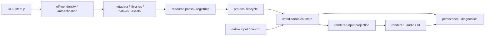

# 总体架构与主链路

## 目标边界

BBB 是 Minecraft Java 26.1 的 repo-native 客户端，不是官方 jar、Bevy、Azalea 或其他
客户端栈的 wrapper。服务端拥有多人世界权威；客户端拥有 protocol 解码、可见世界
副本、本地预测、资源、渲染、音频、UI、输入、持久化和诊断边界。

该图是所有权链，不表示每个系统都复制状态。packet 只在 protocol/net 边界被解释，
持续状态进入 world，瞬时副作用通过显式 effect 接口，renderer 每帧只消费已冻结的
输入投影。

## 仓库原生（repo-native）边界

| 边界 | 拥有 | 不拥有 | 输入 → 输出 | 生命周期、fallback 与位置 |
| --- | --- | --- | --- | --- |
| protocol | wire 类型、codec、26.1 生成事实 | socket、世界对象 | bytes ↔ typed packet | 连接版本固定；未知/越界输入拒绝。`bbb-protocol` |
| net/runtime | socket、连接阶段、收发队列 | 世界语义 | typed packet → ordered events | handshake/configuration/play/closed。`bbb-net`、`bbb-native` |
| registries/data | 当前 session registry 与 holder 解析 | GPU 资源 | configuration data → queryable ids | 重连重建；无效引用保留诊断或拒绝。`bbb-world`、`bbb-protocol` |
| resource pack/assets | pack stack、asset-index/object-store、解码预算与 immutable CPU catalog | 绘制状态 | providers → `ClientResourceGeneration` → `bbb-render-types` 窄投影 | reload 原子发布，失败保留旧 generation。`bbb-pack`、`bbb-item-model` |
| world | chunk、entity、block entity、UI canonical state | GPU/audio backend | play packet/local action → world/effects | session scoped；断线清理。`bbb-world` |
| renderer input | 一帧一致的 terrain/entity/UI projection | canonical world | world + resources → frame | 每帧重建或增量提取；缺资源走明确 placeholder。`bbb-native`、`bbb-render-types` |
| renderer | GPU resources、pipelines、排序 | 游戏权威状态、pack resolver/catalog | frame + 纯资源投影 → presented image | swapchain/pack generation scoped；生产依赖不反向指向 `bbb-pack`。`bbb-renderer` |
| native control/input | window events、local intent、control snapshot | 服务端权威移动 | OS input → intent/packet | focus 与连接阶段限定。`bbb-native`、`bbb-control` |
| UI | screen/HUD transient presentation | packet truth | world/input/resources → quads/text | screen lifecycle；缺字体使用 missing glyph。`bbb-native`、`bbb-render-types` |
| audio | device/backend voices | 世界音效真值 | world audio event → playback | backend 重建；无设备时静默且可诊断。`bbb-audio` |
| persistence | options/server/hotbar 等本地文件 | session world | typed snapshot ↔ atomic files | lazy load/save；错误恢复有边界。相关 native modules |
| benchmark/validation | replay、合同、parser、summary | 外部大产物 | fixed workload → evidence | 工具和 raw capture 在仓库外。`scripts/official_client_benchmark.py` |

## 与 Vanilla owner 的关系

Vanilla 常把状态与行为集中在 `Minecraft`、`ClientPacketListener`、`ClientLevel`、
`LevelRenderer`、`LocalPlayer` 等对象中。BBB 不照搬 Java 类图，而复刻可观察决策及其
输入顺序，再把责任放入上表的语义边界。类型布局可以不同，但 packet 顺序、坐标、
fallback 和消费者看见的事实不能因此改变。

## 状态流和验证

完整的 packet 主链见[客户端状态流](../mechanisms/protocol/client-state-flow.md)，状态
分类见[边界与状态分类](client-boundaries.md)，机制覆盖见
[parity matrix](../parity/vanilla-26.1-matrix.md)。当前工作和缺口分别只由
[`goal.md`](../../../goal.md)与
[`unsupported-features.md`](../../unsupported-features.md)调度。
